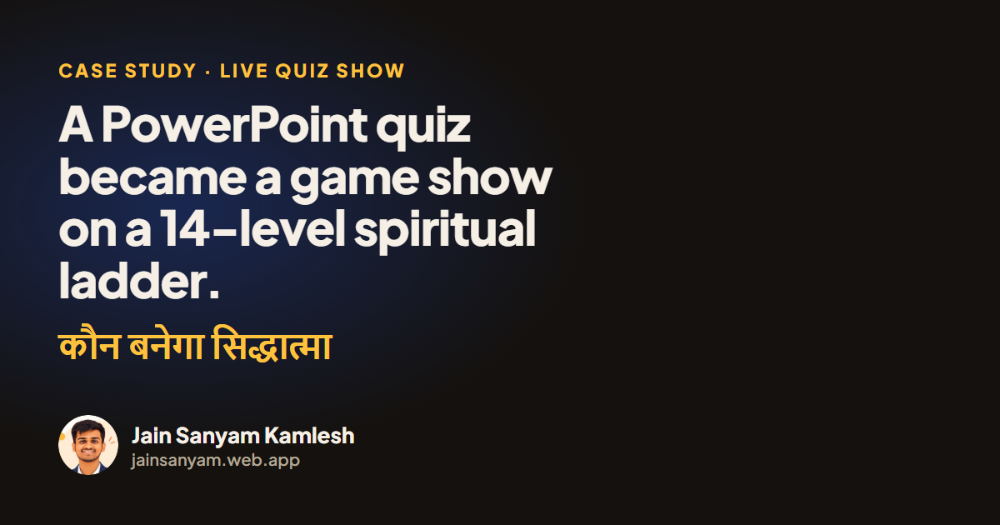

# कौन बनेगा सिद्धात्मा (Kaun Banega Siddhatma)

**A KBC-style live game show on Jain philosophy. The host's laptop, the projector and the audience's phones work as one system.**

🌐 **Live:** [kounbanegasiddhatma.web.app](https://kounbanegasiddhatma.web.app) · 📖 **Case study:** [jainsanyam.web.app](https://jainsanyam.web.app/case-studies/kaun-banega-siddhatma)



| | |
|---|---|
| **My role** | Product manager & builder (solo) |
| **Built** | 15–17 September 2026 |
| **Content** | 70 questions · 14 levels |
| **Status** | Live · still runs on the [Sarvodaya Ahinsa Games](https://github.com/jsanyam08/sarvodaya-ahinsa-games) platform |

---

## The starting point

The NGO's quiz on Jain philosophy lived in a PowerPoint deck I had written. A deck can show a question, but it can't keep score, run a clock, hide two options for 50:50, or let a hall of people vote.

## The idea

Everyone in India knows how *Kaun Banega Crorepati* works, so borrowing that format means nobody needs the rules explained. But prize money felt wrong for this audience, so the ladder is **spiritual progress**:

- **14 levels**: the 11 श्रावक प्रतिमा (the householder's stages of vows), then मुनि दीक्षा, केवलज्ञान and सिद्ध पद, which completes the show's title
- **70 questions**, 5 per level, each with its 50:50 pair
- **Safe levels** 7, 12 and 14; the clock grows from 30 → 60 → 120 seconds

## How it works

| Screen | Role |
|---|---|
| 🎛️ **Host laptop** (`site/host.html`) | The only screen that can change anything. Every step of a question is one key: `L` load · `1` show · `2` options · `5` timer · `A–D` lock · `3`/`4` right/wrong · `7` explain |
| 📺 **Projector** (`site/screen.html`) | Read-only, so a refresh mid-show is always safe |
| 📱 **Every phone** (`site/index.html`) | Can write only its own answer, once |

**Four lifelines:** 50:50, 📊 audience poll (every phone in the hall votes), 💡 expert, 📞 call (60-second timer).

**Audience rounds between contestants:** Fastest Finger First (items arrive shuffled on every phone; the Top 10 score 50 down to 5 points) and an audience question (+10 for everyone who gets it right).

**Two halls at once:** rooms (MAIN and KHATAULI on show day) keep separate state and share one question bank.

## Built to survive a real hall

- The audience link goes to strangers, so **database rules** make sure no phone can wipe the bank or push a fake question
- The projector only reads, so a dropped connection pauses the show and never loses it
- Devanagari fonts and a phone-hotspot fallback for venue Wi-Fi

## What it taught me

The best parts of KBS were the parts the hall played: the poll and the phone rounds. Two days later I built a platform where *every* round is played on phones: [Sarvodaya Ahinsa Games](https://github.com/jsanyam08/sarvodaya-ahinsa-games).

## Tech

Plain HTML, CSS and JavaScript · Firebase Hosting + Realtime Database (free tier) · anonymous auth for phones, an admin list for hosts.

```
site/
  host.html           host controller + question bank editor
  screen.html         projector
  index.html          audience phone (also served at /join)
database.rules.json   Realtime Database security rules
docs/SETUP.md         first-time setup and show-day guide
```

The question bank is kept out of this repo on purpose: it holds the answers for future shows.

---

Built by **Jain Sanyam Kamlesh**, with Claude (Anthropic) as my engineering partner. The format, ladder, rules and testing are mine.
